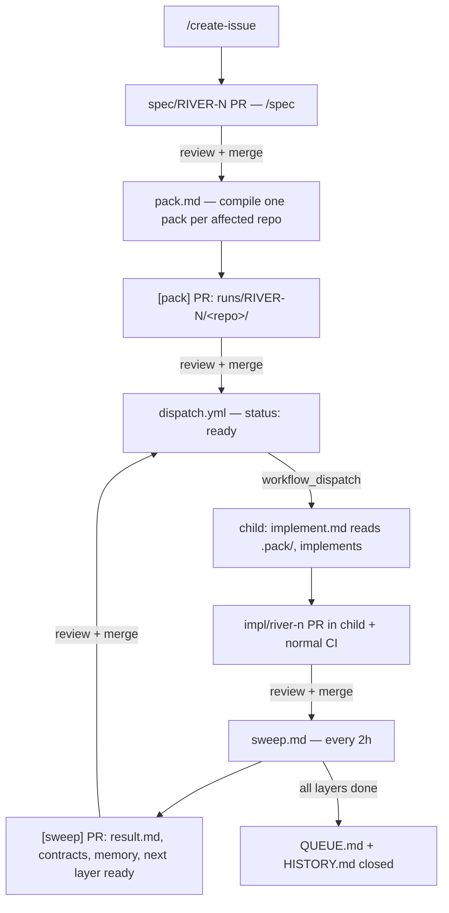

# How it works V2 — Supervisor and code-only repos

V2 splits the monorepo. `river-spec` (this repo) holds everything that is not code: specs, plans, project
context, contracts, skills, memory and the agent workflows. Every other repo holds only code, its CI and one
generic gh-aw workflow. A child repo has no specs, no `AGENTS.md`, no `CLAUDE.md`; all context arrives in a pack.

## Repos

| Repo | Layer | Holds | Produces | Needs |
|------|-------|-------|----------|-------|
| river-spec | — | specs, plans, `stack.yaml`, `contracts/`, `harness/`, `runs/`, workflows | | |
| river-common | 1 | `river-config` crate | `river_config_tag` | |
| river-ingest | 2 | `river-sidecar`, `river-ingestion`, ClickHouse migrations | `clickhouse_schema`, `s3_key_schema` | `river_config_tag` |
| river-query | 3 | `river-query-api`, `openapi.json` | `openapi` | `river_config_tag`, `clickhouse_schema` |
| river-ui | 4 | Flutter app | | `openapi` |
| river-infra | 4 | docker-compose, Grafana, demo app | | `clickhouse_schema` |

`stack.yaml` is the only file that knows all of them.

## Flow



Human gates, same spirit as V0: the spec PR, the pack PR (what the agent will know), each child impl PR, and
each sweep PR (what the supervisor learned). Nothing merges itself.

## The pack

```
runs/RIVER-N/
  rollout.md                 # repo | layer | status | PR | notes
  <repo>/
    manifest.yaml            # repo, branch, status, needs, produces, allowed-files, checks, skills
    task.md                  # this repo's slice of the spec only
    context.md               # <= ~60 lines of SPEC.md decisions and contract values
    memory.md                # copy of harness/memory/<repo>.md
    skills/<name>/SKILL.md   # copied from harness/skills
    contracts/               # files behind `needs`, e.g. openapi.json
    tools/                   # e.g. check-duplication for Rust
    result.md                # written by sweep after merge
```

Status: `waiting -> ready -> dispatched -> done | blocked`. A repo waits while another affected repo in the
same task still has to produce something it needs. Packs stay in this repo, so every run is auditable:
the exact context an agent had is in git.

## Workflows

| Workflow | Where | Kind | Trigger | Does |
|----------|-------|------|---------|------|
| `pack.md` | river-spec | gh-aw | spec PR merged, or manual `task` | writes packs, opens `[pack]` PR (may only touch `runs/**`) |
| `dispatch.yml` | river-spec | plain | push to main changing a manifest | `gh workflow run implement.lock.yml` in each child whose manifest became `ready` |
| `sweep.md` | river-spec | gh-aw | every 2h, or manual | reads child PRs, writes results, updates contracts/memory/queue, releases next layer |
| `implement.md` | every child | gh-aw | `workflow_dispatch` (task, pack, spec_ref) | sparse-checks out the pack into `.pack/`, implements, runs checks, opens `impl/river-n` PR |
| `ci.yml` | every child | plain | PR, push to main | fmt/clippy/test or flutter analyze/test |

`implement.md` is identical in every child. Child agents report back only through their PR body
(`## Outputs`, `## Notes for memory`, `## Open questions`), which `sweep.md` reads.

## Secrets

| Secret | Repo | Purpose |
|--------|------|---------|
| `ANTHROPIC_API_KEY` | river-spec and every child | gh-aw `engine: claude`. Agents run unattended in Actions, so this is API billing, not the Pro subscription |
| `RIVER_DISPATCH_TOKEN` | river-spec | fine-grained PAT, Actions read/write on the five child repos |
| `RIVER_CI_TOKEN` | every child | fine-grained PAT, Contents write on that repo; pushes an empty commit so agent PRs trigger CI |

## Differences from V1

- No shared tracking files in code repos, so RIVER-14 (parallel specs colliding on `QUEUE.md`/`HISTORY.md`)
  disappears: only `sweep.md` writes them.
- "One impl PR at a time" becomes one open `impl/*` PR per child repo; layers run in parallel across repos.
- `/spec-dev`, `/plan-dev`, `/pr-merge` move to `harness/legacy-v1/commands/` (monorepo flow).
- SonarQube now needs one SonarCloud project per child; not configured yet.
- The local `/spec`, `/create-issue`, `/create-feature` commands still author specs here.
